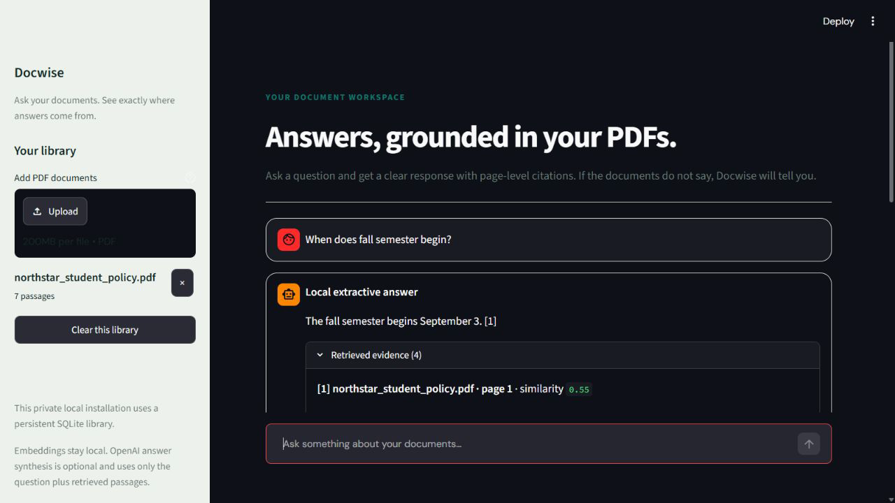
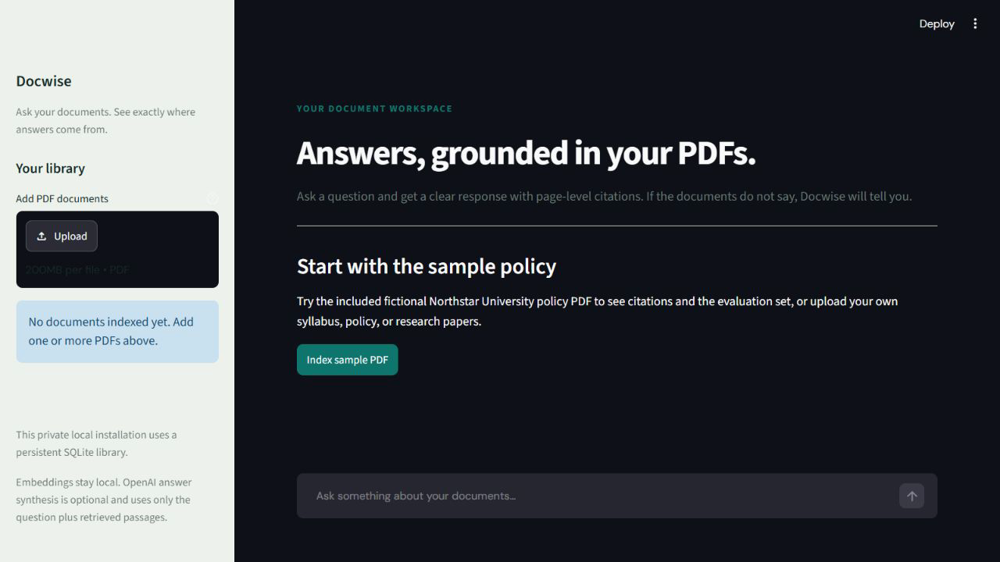
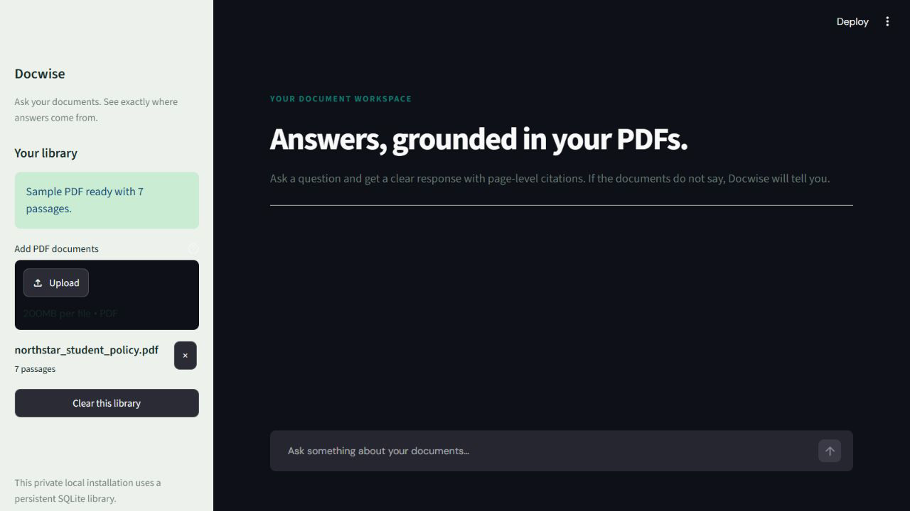
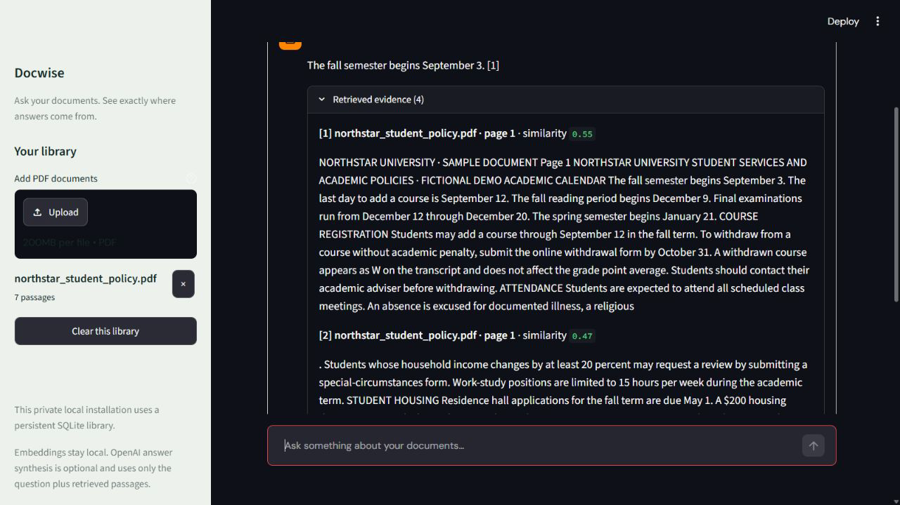
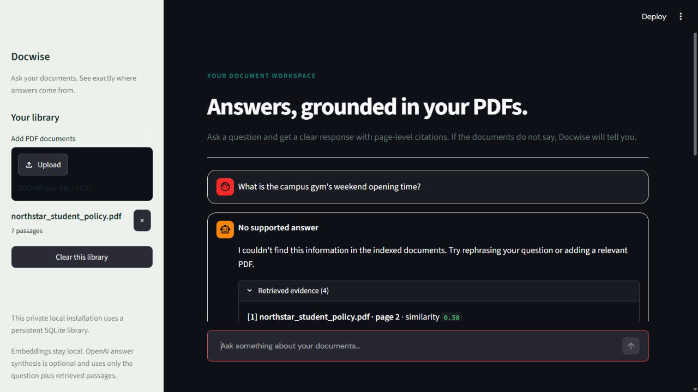
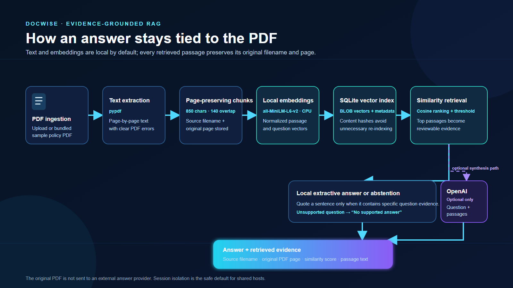

[Static banner fallback](assets/docwise-banner.png)

# Docwise — RAG Chatbot for PDF Documents

> Ask a PDF a question, inspect the retrieved evidence, and see the original filename and page behind the answer.


**Live deployment:** [docwise-rag-chatbot.vercel.app](https://docwise-rag-chatbot.vercel.app) — verified in API-key-free mode with the fictional Northstar University sample PDF.

[Watch the verified 84-second local demo](assets/demo.mp4) · [View the benchmark](evaluation/results.md) · [Open the fictional sample corpus](documents/northstar_student_policy.pdf)

> **Demo-content notice:** Northstar University and every policy in the bundled sample PDF are fictional. They are included only to demonstrate the application and evaluation workflow.

## What problem does it solve?

Reading a policy, syllabus, or paper to find one rule is slow; trusting an uncited chatbot answer is risky. Docwise is a small, inspectable RAG application that indexes text-based PDFs locally, retrieves page-level passages, and makes that evidence visible next to the response.

The app favors an honest answer over a confident guess. When its local extractor cannot support a response, it displays **No supported answer** even if semantically related passages were retrieved.

## Demo

The video was rendered from real local app captures using only the included fictional corpus. It has no music and makes no claim of a deployed URL or API-backed result.

[](assets/demo.mp4)

## Screenshots from the working app

### Empty-library start screen



### Start, upload, or index the included PDF



### Grounded local answer with page-level evidence


### Review all retrieved passages and scores



### Abstention for an unsupported question



## Key features

- Page-preserving text extraction with `pypdf`.
- Overlapping passages (about 850 characters with 140-character overlap).
- Local CPU embeddings via `sentence-transformers/all-MiniLM-L6-v2`.
- SQLite persistence for normalized vectors, source filenames, pages, and text.
- Cosine-similarity retrieval with a configurable threshold.
- Visible filename, original page, similarity score, and passage text for every displayed result.
- API-key-free local extractive answering; optional OpenAI Responses API synthesis.
- Clear distinct states for synthesized, local-fallback, local-extractive, and unsupported answers.
- User-readable handling for empty, malformed, encrypted, and image-only PDFs.
- Avoids re-embedding an unchanged file with the same name.
- Session-isolated libraries by default for shared hosts.

## How the RAG pipeline works



1. A PDF is uploaded or the fictional sample is indexed.
2. `pypdf` extracts text while preserving each page number.
3. Docwise creates overlapping chunks that retain the original filename and page.
4. `all-MiniLM-L6-v2` generates normalized CPU embeddings.
5. SQLite stores vectors and source metadata for the configured library.
6. A question is compared against passages with cosine similarity.
7. Threshold-qualified passages become reviewable evidence.
8. The local extractor quotes a supported sentence or abstains.
9. With an API key, only the question and retrieved passages—not the complete PDF—are sent to OpenAI for optional synthesis.
10. The UI shows answer mode and evidence so a reviewer can check the claim.

## Technology stack

| Area | Implementation |
|---|---|
| UI | Streamlit |
| PDF parsing | `pypdf` |
| Embeddings | Sentence Transformers `all-MiniLM-L6-v2` on CPU |
| Vector persistence | SQLite BLOB vectors plus source metadata |
| Retrieval | Normalized dot product / cosine similarity |
| Answering | Local extractive fallback; optional OpenAI Responses API synthesis |
| Validation | Isolated 25-question retrieval and abstention benchmark |

## Repository structure

```text
app.py                         Streamlit interface and session-library handling
rag.py                         Extraction, chunks, embeddings, SQLite, retrieval, answers
evaluate.py                    Isolated benchmark runner
tests/test_rag.py              Small regression suite for retrieval safeguards
requirements.txt               Tested dependency ranges for Python 3.11
.env.example                   Safe configuration template; no secrets
documents/                     Fictional sample PDF and its editable source text
evaluation/                    Benchmark cases and verified results
assets/                        Real screenshots, demo video, banner, architecture graphic
data/                          Runtime model cache and local index; ignored by Git
```

## Run locally

### Requirements

- Python 3.10 or newer; Python 3.11 was used for the verified run.
- Internet access on first embedding-model download.
- At least 4 GB RAM is a practical minimum; CPU-only indexing is slower on smaller machines.
- An OpenAI API key is optional. The core demo and local fallback work without one.

### Windows PowerShell

```powershell
py -3.11 -m venv .venv
.\.venv\Scripts\Activate.ps1
python -m pip install --upgrade pip
python -m pip install -r requirements.txt
Copy-Item .env.example .env
python -m streamlit run app.py
```

### macOS or Linux

```bash
python3 -m venv .venv
source .venv/bin/activate
python -m pip install --upgrade pip
python -m pip install -r requirements.txt
cp .env.example .env
python -m streamlit run app.py
```

Open the local URL Streamlit prints. Choose **Index sample PDF**, then ask “When does the fall semester begin?” First launch downloads the embedding model; later runs reuse its cache.

## Configuration

Copy `.env.example` to `.env`. The template contains placeholders only and `.env` is ignored by Git.

| Variable | Default | Purpose |
|---|---|---|
| `OPENAI_API_KEY` | unset | Enables optional OpenAI answer synthesis. |
| `OPENAI_MODEL` | `gpt-4.1-mini` | Model requested for optional synthesis. |
| `EMBED_MODEL` | `sentence-transformers/all-MiniLM-L6-v2` | Local model for passages and questions. |
| `SIMILARITY_THRESHOLD` | `0.39` | Minimum cosine similarity for a passage to be considered. |
| `VECTOR_DB_PATH` | `data/vectors.sqlite3` | Optional SQLite location in persistent mode. |
| `DOCWISE_LIBRARY_MODE` | `session` | `session` isolates browsers; `persistent` is for a private local installation. |

### Optional OpenAI synthesis

If `OPENAI_API_KEY` is set, Docwise sends only the user question and threshold-qualified retrieved passages to OpenAI. The original PDF is not uploaded by the app. The synthesis prompt restricts the answer to those passages and requires citation markers such as `[1]`.

If a provider request fails—for example due to missing access, a rate limit, or a network failure—the app labels the result as a local fallback or unsupported answer. It does not show a raw provider traceback or silently present a failed call as a synthesized response.

## Source attribution and abstention

Each chunk retains its original source filename and page. A local citation such as `[1]` maps to a visible entry in **Retrieved evidence**, which displays source, original PDF page, similarity score, and chunk text.

Similarity is not proof. If the local sentence extractor cannot find specific question evidence, Docwise returns **No supported answer**. Related passages may still be shown for inspection, but are not presented as support for the answer.

## Verified benchmark

Run the included benchmark from the repository root:

```bash
python evaluate.py
```

The runner sets a temporary SQLite path before importing the RAG module, so it does not clear or overwrite the normal document library.

The verified 2026-10-29 run used Python 3.11, the bundled fictional PDF, `all-MiniLM-L6-v2` on CPU, and threshold `0.39`.

| Measure | Verified result |
|---|---:|
| Answerable questions with expected evidence | 18/19 (95%) |
| Unanswerable questions rejected by threshold alone | 4/6 (67%) |
| Unanswerable questions declined by local extraction | 6/6 (100%) |
| Combined evidence and abstention checks | 24/25 (96%) |

This is a small, corpus-specific retrieval and local-abstention check—not an accuracy guarantee, a general RAG benchmark, or a score for OpenAI-generated answers. The retained retrieval miss is the spring-semester start-date question. Full methodology is in [evaluation/results.md](evaluation/results.md).

## Privacy and data handling

- By default, each browser session receives a separate SQLite library in host temporary storage, preventing app-level cross-session search.
- Session-library files are not automatically removed when a browser closes. **Clear this library** removes that session database. Do not use a shared host for confidential documents unless its storage controls are appropriate.
- `DOCWISE_LIBRARY_MODE=persistent` is for a private, single-user local installation.
- Local extraction, chunking, embeddings, and retrieval do not call OpenAI.
- If optional synthesis is configured, only the question and retrieved passages leave the app; the original PDF does not.
- The embedding weights download from Hugging Face on first use and are cached locally.

## Deployment

The app was validated locally with Python 3.11 and starts from the repository root with `python -m streamlit run app.py`. It now includes `Dockerfile.vercel`, the documented Vercel Container Runtime route for an HTTP server that is not a native ASGI/WSGI application.

The container starts Streamlit on Vercel's `$PORT`, limits uploads to 4 MB to stay under Vercel's 4.5 MB Function request-body limit, forces session-scoped libraries, and writes Hugging Face model downloads to `/tmp`. The filesystem and session state are therefore ephemeral; uploaded documents must not be treated as durable or private storage. The image pins CPU-only PyTorch so deployment does not package CUDA runtime dependencies.

The current production deployment was verified in a fresh browser session on 2026-10-29: it indexed the bundled sample into seven passages, answered the fall-semester question with a page-1 citation, and returned **No supported answer** for the unsupported campus-gym question. It runs without an OpenAI key.

For a redeployment, use the existing `main` branch and `Dockerfile.vercel`. Leave secrets empty for the API-key-free demo, or configure `OPENAI_API_KEY` only in Vercel's environment-variable settings. First indexing after an instance cold start downloads `all-MiniLM-L6-v2`, so it can take longer than subsequent requests. Vercel's Container Runtime is beta and uses Active CPU pricing; monitor account usage if sharing the demo broadly.

## Troubleshooting

| Symptom | What to check |
|---|---|
| First indexing is slow | The embedding model downloads and initializes on first use. |
| “No extractable text found” | The PDF is likely scanned/image-only; run OCR first. |
| PDF cannot be read | Use an unlocked, valid PDF; malformed and encrypted files are rejected clearly. |
| Question is unsupported | Rephrase it, add a relevant PDF, or inspect the passages. Do not treat related text as proof. |
| OpenAI synthesis is unavailable | The local fallback still works; check key, model access, network, and rate limit if synthesis is needed. |
| Library disappeared after browser restart | That is expected in `session` mode; use persistent mode only for a private local install. |

## Known limitations

- Text-based PDFs only; there is no OCR pipeline for scanned documents.
- The SQLite index uses an in-process linear scan, suitable for the demo but not a large multi-user corpus.
- Quality depends on the corpus, embedding model, threshold, and question phrasing; the bundled benchmark still misses one answerable retrieval case.
- The local fallback extracts one supported sentence, not a long-form synthesis.
- OpenAI-backed synthesis was not included in the verified benchmark because no authorized API key was configured.
- Session isolation is not a substitute for production authentication, encrypted storage, tenant isolation, or a formal retention policy.

## Future improvements

- Add OCR for scanned PDFs.
- Add reviewed, citation-aware answer evaluation.
- Add authentication and an external vector store only when a real multi-user deployment requires them.
- Add document metadata filters and configurable retrieval diagnostics.
- Compare retrieval models and thresholds on a representative reviewed corpus.

## License

No license file is currently included. Add an appropriate license before inviting reuse beyond portfolio review.
